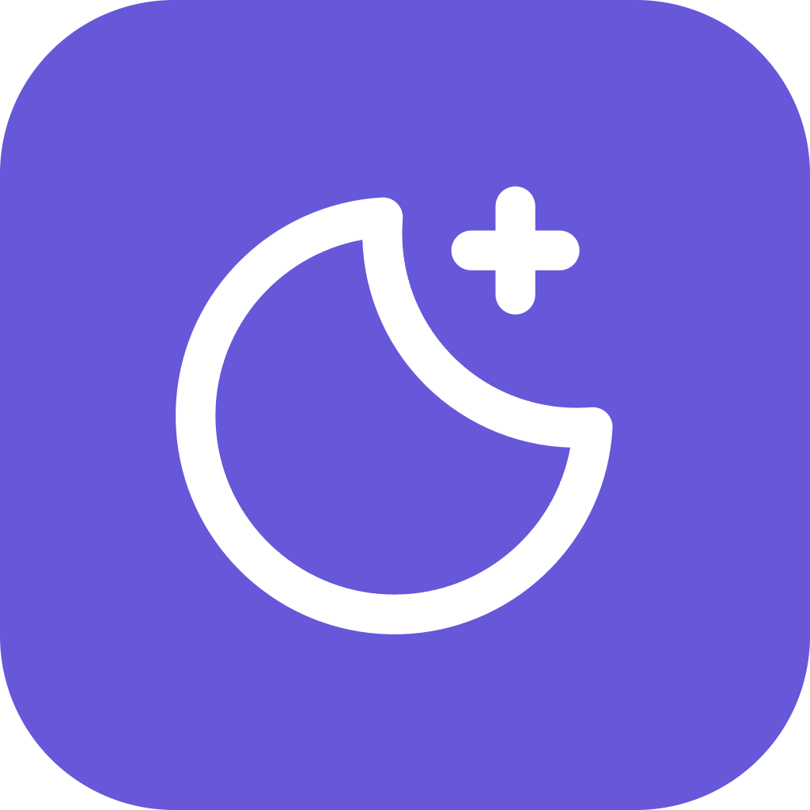
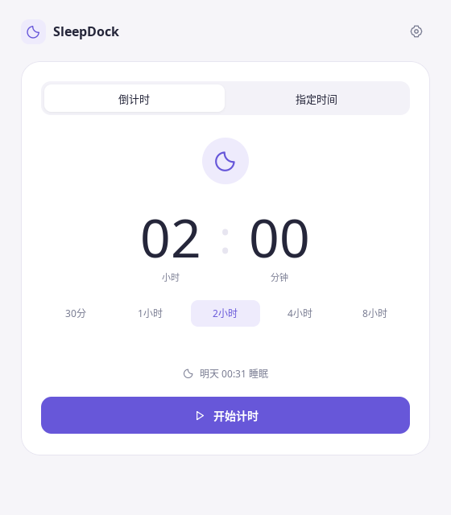
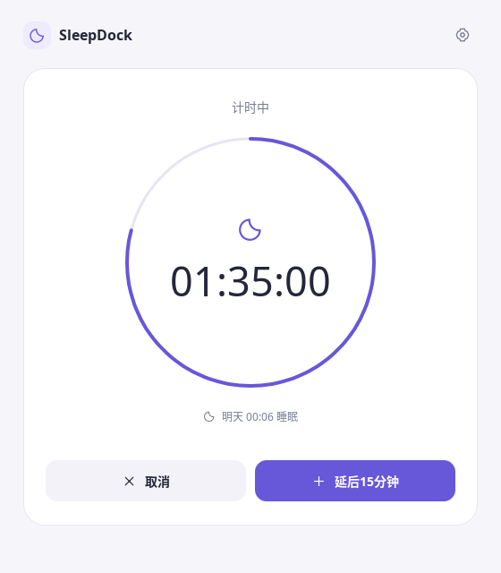
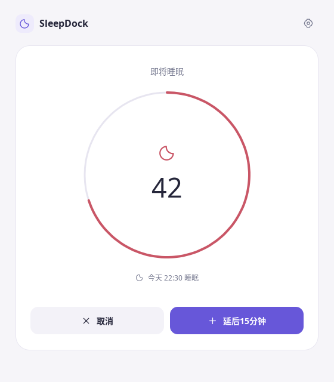
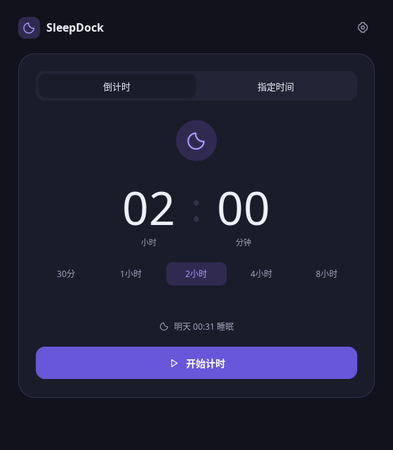

<h1 align="center"> SleepDock</h1>

<p align="center"><strong>基于 Go 与 <a href="https://github.com/egoist/mygo">MyGO</a> 的原生定时睡眠工具。</strong></p>

<p align="center"><a href="#界面">界面</a> &nbsp;·&nbsp; <a href="#使用">使用</a> &nbsp;·&nbsp; <a href="#构建">构建</a> &nbsp;·&nbsp; <a href="#验证">验证</a></p>

设好时间，收进托盘。到时提醒一分钟，再让电脑进入睡眠。

SleepDock 是一个独立应用，支持 Windows x64、macOS Apple Silicon / Intel。主界面以时间选择、环形倒计时和操作按钮表达功能，支持浅色、深色与系统主题。运行时无需安装 Go 或 PowerShell。

## 界面

<table>
  <tr>
    <td width="50%"><strong>设定时间</strong><br><br></td>
    <td width="50%"><strong>计时中</strong><br><br></td>
  </tr>
  <tr>
    <td><strong>最后一分钟</strong><br><br></td>
    <td><strong>深色主题</strong><br><br></td>
  </tr>
</table>

<sub>图片由 MyGO 离线渲染生成，时间为示例值；截图过程不会让电脑睡眠。</sub>

## 使用

1. 解压对应系统的 ZIP。Windows 运行 `SleepDock.exe`；macOS 将 `SleepDock.app` 放入“应用程序”。
2. 在“倒计时”中选时长，或在“指定时间”中选时刻；下方直接显示预计睡眠日期与时间。
3. 点击“开始计时”。有活动计划时，关闭窗口会收进托盘；托盘菜单可查看、延后、取消或退出。
4. 到时会显示提醒窗口和系统通知。最后 60 秒内可取消或延后，无人操作则请求睡眠。

当前为开发构建，未完成 Windows 代码签名、Apple Developer ID 签名或公证。macOS 首次运行可能需要在核实来源后通过系统“隐私与安全性”设置允许打开。

### 时间规则

- 倒计时提供 30 分钟、1 小时、2 小时、4 小时和 8 小时快捷项，也可直接输入小时与分钟，范围为 1 分钟至 24 小时。
- 指定时间使用本机时区；当天该时刻已过去时安排到次日，并显示“明天”。
- 输入时间是提醒触发时间，之后额外保留 60 秒取消机会；界面展示的预计睡眠时间已包含这 60 秒。实际事件处理延迟时仍保留完整提醒时间。
- “延后15分钟”将尚未到达的计划时刻后移 15 分钟；在提醒期间操作则从当前时刻重新计时 15 分钟，随后仍有 60 秒提醒。
- **遵循系统已有电源计划，不保持唤醒。** 电脑提前自动或手动睡眠时，本次计划结束；唤醒后不会补执行或再次睡回去。
- 一次只运行一个计划。完整退出会取消当前计时；重新启动只恢复上次输入与主题，不恢复旧计划，也不会默认开机自启。
- 睡眠请求失败时保留“重试”和“详情”。重试会重新给予 60 秒提醒，避免立即请求睡眠。

系统通知受本机权限与勿扰设置影响；计时到点时应用也会显示提醒窗口。Windows 请求普通睡眠，macOS 使用系统 `pmset sleepnow`，应用不强制终止其他程序，不修改全局电源设置。

### 设置

右上角齿轮切换主题。设置文件位于：

| 系统 | 路径 |
| --- | --- |
| Windows | `%APPDATA%\SleepDock\settings.json` |
| macOS | `~/Library/Application Support/SleepDock/settings.json` |

文件只保存上次输入和主题，使用原子替换；损坏设置在重写前保留备份。没有 GitHub 登录或其他账户依赖。

## 构建

使用 Go 1.27.1 和 MyGO v0.5.5：

```sh
go test ./...
go run ./cmd/sleepdock --config-dir ./artifacts/dev-config
```

生成八种离线界面预览：

```sh
go run ./cmd/preview -out artifacts
```

打包脚本使用 Python 标准库，通过固定版本 MyGO CLI 生成图标、Windows 清单和 macOS 应用包，收集许可证并写入 SHA-256：

```sh
python3 scripts/package.py
python3 scripts/package.py --targets windows/amd64
python3 scripts/package.py --go /path/to/go
```

输出为 `dist/SleepDock-0.1.0-windows-amd64.zip`、`dist/SleepDock-0.1.0-macos-arm64.zip`、`dist/SleepDock-0.1.0-macos-amd64.zip` 和 `dist/SHA256SUMS.txt`。Windows 中可以用 `python` 替代 `python3`。

## 验证

```sh
go test ./...
go test -race ./internal/...
go vet ./...
```

测试覆盖跨午夜、提醒、延后、取消、重复触发保护、系统提前睡眠、失败重试、持久化及 MyGO 内存界面交互。测试使用虚拟时钟和模拟电源接口，**不会让测试机睡眠**。

当前开发环境为 Linux；Windows / macOS 的原生托盘、系统通知、实际睡眠与唤醒需按[实机验收清单](docs/ACCEPTANCE.md)验证。

开发维护从[项目交接文档](HANDOFF.md)开始，包含架构入口、时间状态机、平台适配、验证边界与后续工作。

## 开源协议

[MIT License](LICENSE)。第三方许可见 [THIRD-PARTY-NOTICES.txt](THIRD-PARTY-NOTICES.txt) 和 `licenses/`。
